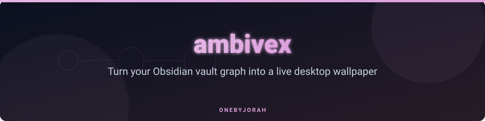
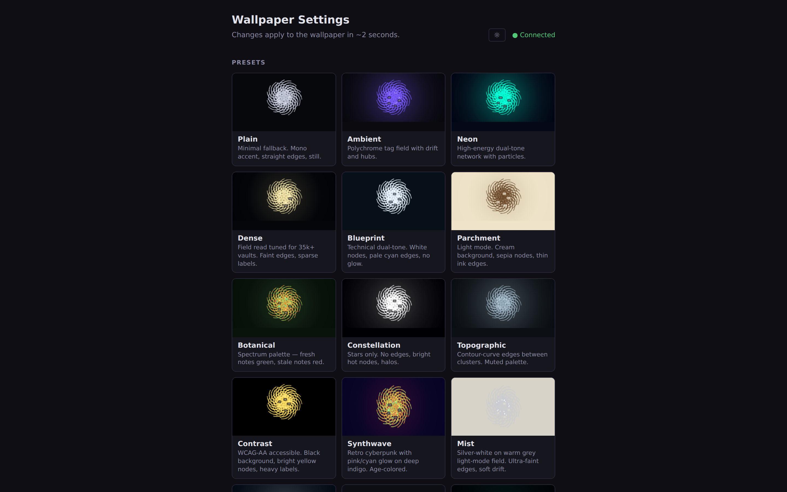
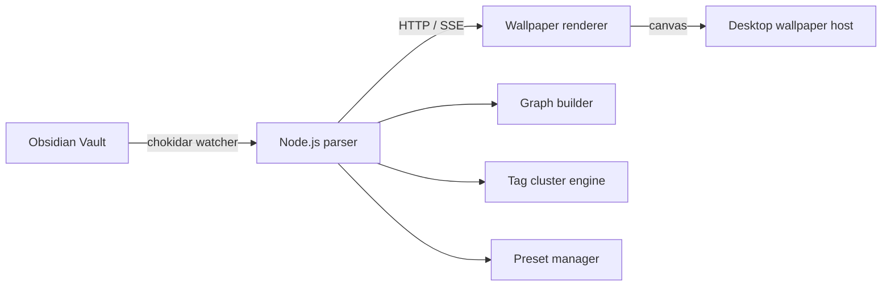

<div align="center">



# ambivex

**Turn your Obsidian vault graph into a live desktop wallpaper** — for anyone who wants their knowledge base on screen all day.  
*Formerly AmbientOS.*

<a href="https://github.com/OneByJorah/ambivex/actions/workflows/ci.yml"></a>
<a href="https://github.com/OneByJorah/ambivex/pkgs/container/ambivex"></a>
<a href="LICENSE"></a>
<a href="https://github.com/OneByJorah/ambivex/stargazers"></a>


</div>


## Why this exists

Your notes are a living graph, but you only see it when Obsidian is open. ambivex parses a vault into nodes and edges and renders it continuously behind your desktop, refreshing as files change. It ships with 18 hand-tuned presets — from Plain and Ink to Synthwave and Vapor — and a settings UI for tuning physics, glow, depth of field, and clustering without touching config files.

## Quick start

### Docker (static wallpaper preview)

The fastest way to see the wallpaper UI. This serves the static renderer only; the live settings panel needs the Node server shown below.

```bash
git clone https://github.com/OneByJorah/ambivex.git
cd ambivex
cp .env.example .env
docker compose up -d --build
```

Open <http://127.0.0.1:9503>. The container is pinned to `127.0.0.1`; no vault is required because the renderer can generate a synthetic demo graph.

### Node.js (full vault wallpaper)

For a real Obsidian vault, live file watching, and the settings UI:

```bash
git clone https://github.com/OneByJorah/ambivex.git
cd ambivex
npm install
cp config.example.json config.json
# edit config.json and set vaultPath to your Obsidian vault
npm start
```

Open the printed URL (default <http://127.0.0.1:3000>) and `/settings.html`. Point your wallpaper host (Plash, Lively Wallpaper, KDE Web Page, Hidamari, xwinwrap) at the root URL.

### One-line run without cloning

```bash
npx ambivex --vault "/path/to/Vault" --port 3000
```

This scaffolds `ambivex.config.json` in the current directory and starts the server.

## Features

- **Knowledge graph wallpaper** — renders vault notes as an animated force-directed graph.
- **18 presets** — Plain, Ambient, Neon, Dense, Blueprint, Parchment, Botanical, Constellation, Topographic, Contrast, Synthwave, Mist, Crystalline, Confetti, Abyss, Ink, Library, and Vapor.
- **Tag clustering** — groups notes by tag with optional cluster halos.
- **Large-vault scaling** — auto-scales rendering for big vaults (default cap of 5,000 rendered nodes).
- **Real-time updates** — `chokidar` watches the vault and re-parses on change (`refreshMs`, default 5000 ms).
- **Settings UI** — live tuning of animation, glow, particles, labels, edge style, and color mode.
- **Headless / demo mode** — append `?synthetic=1500` to render a generated graph with no vault, or `?oneshot=1` for a single paint. Used by the screenshot script and renderer smoke tests.
- **Cross-platform** — dedicated setup guides for [macOS](macos-setup.md), [Windows](windows-setup.md), and [Linux](linux-setup.md).

## Screenshots

| Wallpaper | Settings |
|---|---|
|  |  |

## Architecture



**Components**

- `parser.js` — parses the vault, serves the app, watches for changes, and writes `graph.json`.
- `index.html` — the D3 graph renderer (the wallpaper surface).
- `settings.html` — live settings UI.
- `bin/cli.js` — `npx ambivex` / `olw` entry point.
- `worker.js` — force-simulation worker.
- `renderer-core.js` — shared color/hash/label helpers.
- `presets.json` — all 18 preset definitions.

## Configuration

Settings live in `config.json` (see `config.example.json`). Key fields:

| Field | Default | Description |
|---|---|---|
| `vaultPath` | — | Path to your Obsidian vault |
| `port` | `3000` | Local HTTP port |
| `refreshMs` | `5000` | Vault refresh interval (ms) |
| `motionMode` | `balanced` | Animation intensity (`calm` / `balanced` / `showcase`) |
| `maxRenderedNodes` | `5000` | Node cap for large vaults |
| `clusterByTag` | `true` | Group nodes by tag |
| `edgeStyle` | `line` | Edge rendering (`line` / `curve` / `none`) |
| `nodeColorMode` | `tag` | Node coloring mode (`tag` / `age` / `folder`) |
| `ignorePaths` | `[".obsidian","templates","_archive"]` | Paths excluded from parsing |

> [!TIP]
> Run `npx ambivex --vault <path> --port <n>` to scaffold a config and start immediately; open `/settings.html` for live customization.

## Platform setup

| Platform | Wallpaper host | Notes |
|---|---|---|
| macOS | Plash | Disable browsing mode so clicks pass through; see [macos-setup.md](macos-setup.md) |
| Windows | Lively Wallpaper | See [windows-setup.md](windows-setup.md) |
| Linux | KDE / Hidamari / xwinwrap | See [linux-setup.md](linux-setup.md) |

## Docker image

A pre-built image is published to GitHub Container Registry:

```bash
docker pull ghcr.io/onebyjorah/ambivex:latest
docker run -p 127.0.0.1:9503:8080 ghcr.io/onebyjorah/ambivex:latest
```

The image is non-root (`USER 101`), drops all capabilities, and runs with `no-new-privileges`. The internal nginx port is `8080`.

## Development

```bash
npm install
npm test            # parser smoke + renderer smoke (needs Chrome)
npm start           # starts the full server; needs config.json
```

The renderer smoke test uses a throwaway vault and Chrome; it skips cleanly if no browser is found.

## Roadmap

See [docs/finalization.md](docs/finalization.md) for the shipped 1.0.0 feature set and the remaining backlog.

## Contributing

Contributions are welcome. See [CONTRIBUTING.md](CONTRIBUTING.md) and [CODE_OF_CONDUCT.md](CODE_OF_CONDUCT.md). [Open an issue](https://github.com/OneByJorah/ambivex/issues).

## Security

See [SECURITY.md](SECURITY.md). If you find a vulnerability, please open a private issue or email the maintainer directly rather than posting publicly.

## License

MIT — see [LICENSE](LICENSE).
